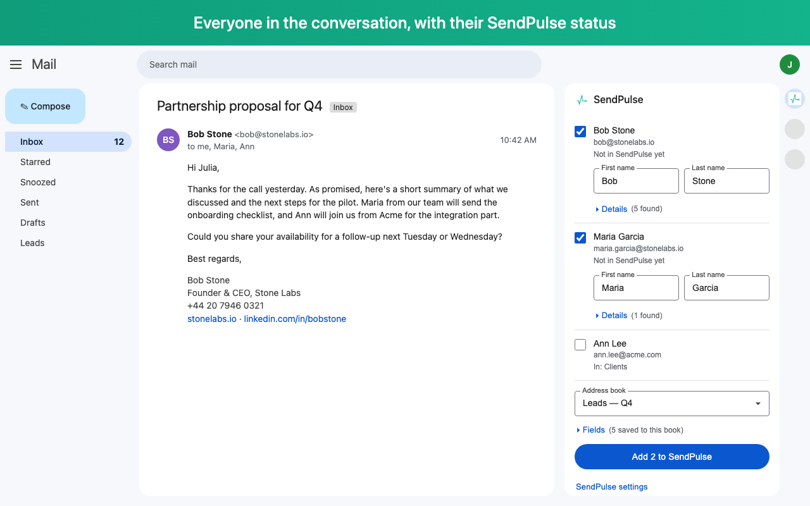

# SendPulse Gmail Extension

Add people from your Gmail conversations to [SendPulse](https://sendpulse.com/) mailing lists in one
click.



Open an email and a **SendPulse** panel in Gmail's right sidebar lists everyone in the conversation:

- which of your SendPulse mailing lists each person is already in;
- first and last name from the email header or the signature;
- phone, company, job title, website and LinkedIn picked up from the sender's signature;
- people who aren't in SendPulse yet are preselected; noreply and notification senders are skipped;
- pick a list and add everyone selected in one click — fields are mapped to the list's variables
  automatically and remembered per list;
- **Find** opens LinkedIn's people search for the contact in a new tab;
- interface in 8 languages: English, Ukrainian, Spanish, German, Portuguese, Polish, Turkish, French.

Sign in with a SendPulse API key (Settings → API → API keys) or with REST API ID and Secret, right in
the panel. Everything goes straight to the official SendPulse API — see the
[privacy policy](PRIVACY.md).

## Development

### Stack

Vue 3 · TypeScript · Vite + [CRXJS](https://crxjs.dev/) · Vitest · ESLint + Prettier

### Run locally

Requires Node ≥ 22 (see `.nvmrc`).

```sh
npm install
npm run dev
```

Then open `chrome://extensions`, enable **Developer mode**, click **Load unpacked** and select
the `dist` directory. With `npm run dev` running, changes reload automatically.

Before the first run, copy `.env.example` to `.env` and set your InboxSDK app ID
(free at [register.inboxsdk.com](https://register.inboxsdk.com)); InboxSDK won't load without it.

### Scripts

| Command             | What it does                                     |
| ------------------- | ------------------------------------------------ |
| `npm run dev`       | dev build with hot reload into `dist/`           |
| `npm run build`     | type-check and production build into `dist/`     |
| `npm run zip`       | production build packed as `sendpulse-gmail.zip` |
| `npm test`          | unit tests                                       |
| `npm run lint`      | ESLint                                           |
| `npm run typecheck` | `vue-tsc` type check                             |
| `npm run format`    | Prettier                                         |

### Translations

The UI is available in English, Ukrainian, Spanish, German, Portuguese (Brazil), Polish, Turkish
and French; Chrome picks the language from the browser's settings (`chrome.i18n`).

All strings live in one table, [scripts/locales.py](scripts/locales.py). Edit it and run
`python3 scripts/locales.py` to regenerate `public/_locales/*/messages.json`; in code use
`t('key', ...substitutions)` from `src/shared/i18n.ts`. `tests/locales.test.ts` checks that every
language has every key with the same `$1`/`$2` substitutions and that the store name and summary
fit their limits.

### Layout

```
src/
  manifest.ts      MV3 manifest (permissions are covered by tests/manifest.test.ts)
  background/      service worker: all network calls to SendPulse, token storage
  content/         Gmail sidebar panel; gmail.ts is the only file that talks to InboxSDK
  options/         options page (Vue)
  shared/          typed messages, field mapping, Material UI components
store/             Chrome Web Store listing, images and their generator
```

### Publish

Bump `version` in `package.json`, run `npm run zip` and upload `sendpulse-gmail.zip` in the
[Chrome Web Store developer dashboard](https://chrome.google.com/webstore/devconsole). Listing
texts, images and the privacy answers are in [store/](store/README.md).
